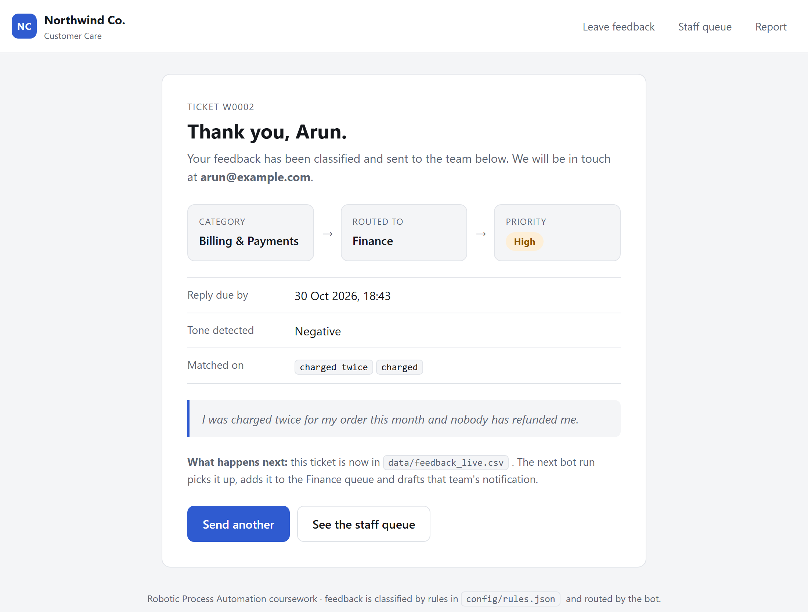
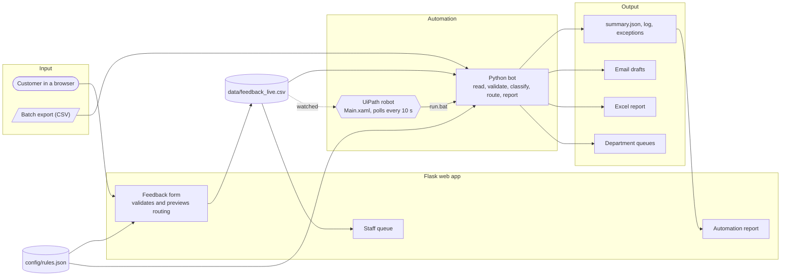
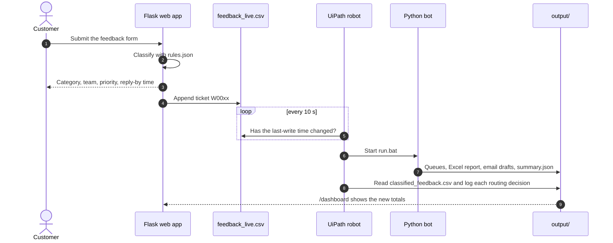
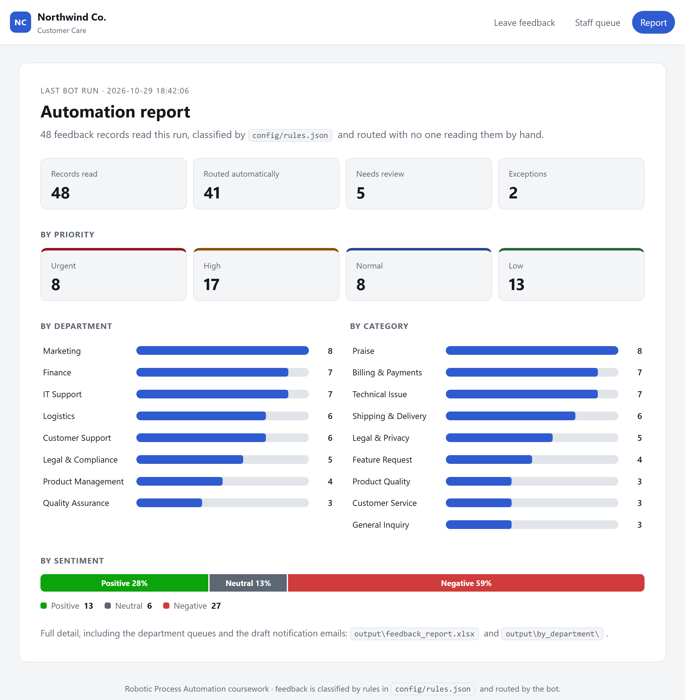
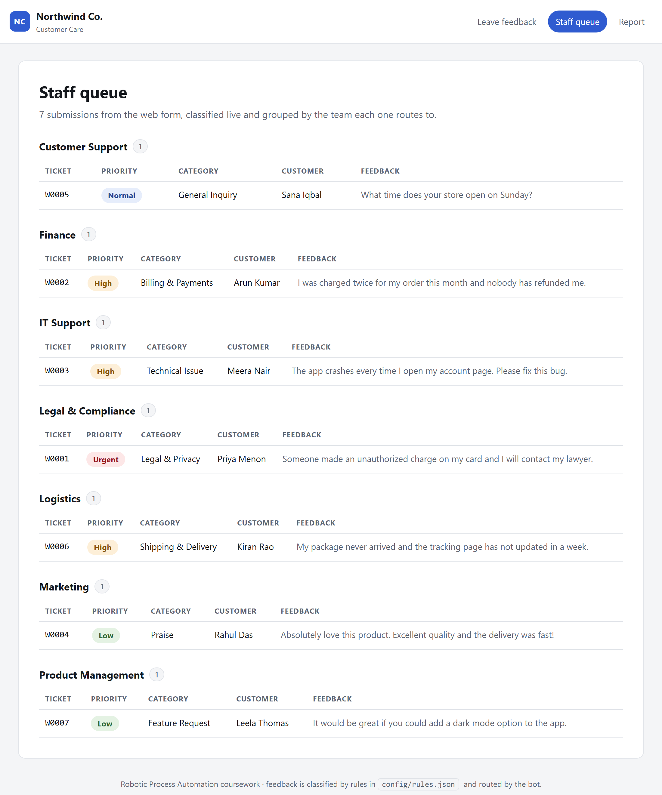
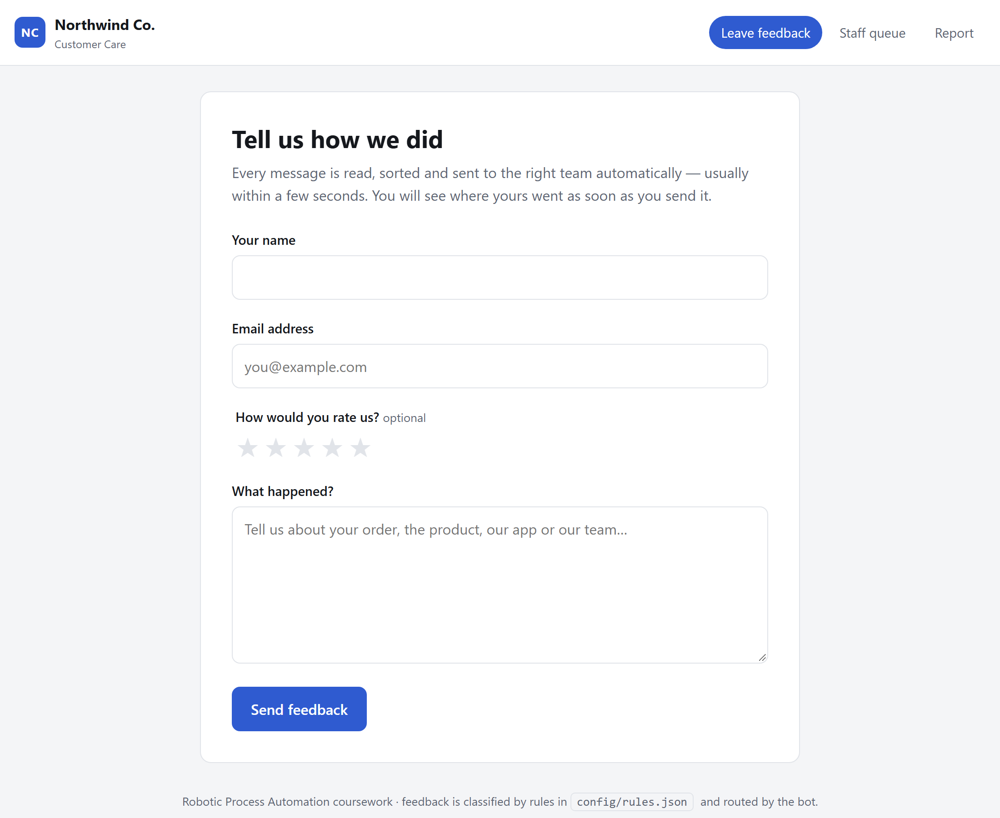
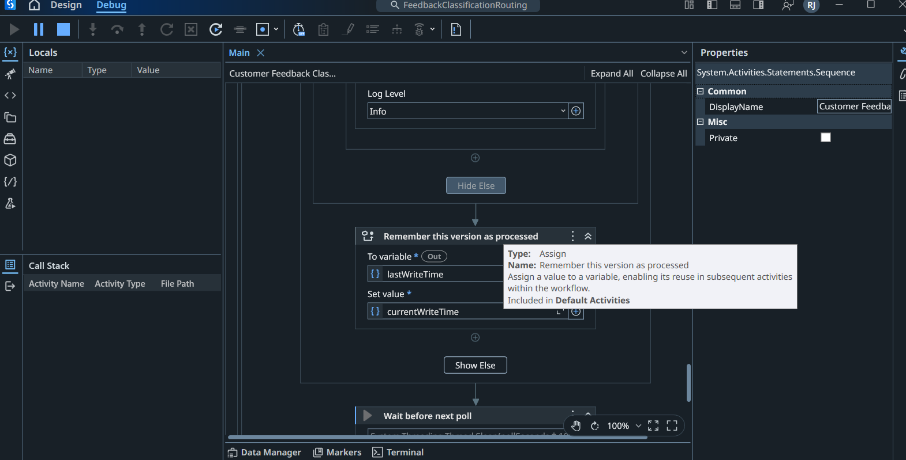
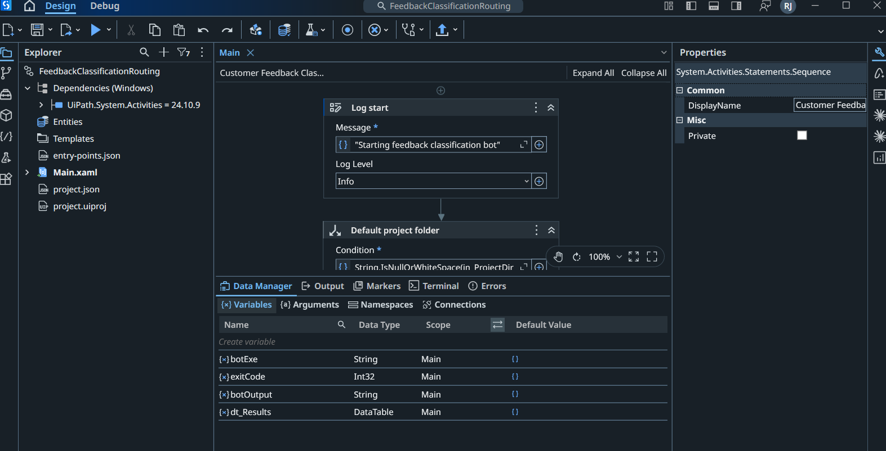

<div align="center">

# Customer Feedback Classification & Routing

**An RPA bot that reads customer feedback, works out what it's about, how upset the customer is and how urgent it is, then routes it to the right team with a reply-by deadline. A UiPath robot runs it, and a web app feeds it in real time.**

[](https://github.com/rishijayanath24-cpu/customer-feedback-rpa/actions/workflows/tests.yml)


[](LICENSE)

<picture>
  <source media="(prefers-color-scheme: dark)" srcset="docs/images/result-dark.png">
  
</picture>

<sub>A customer submits feedback and sees straight away where it went, why, and when to expect a reply.</sub>

</div>

---

## Highlights

- **Explainable classification.** Weighted keyword and phrase rules sort each message into one of 8 categories (123 keywords in total). Every decision records the exact keywords that triggered it, so nothing is a black box.
- **It doesn't guess.** A weak match, or a tie between two categories, goes to **Needs Review** instead of being routed silently. Invalid rows (empty text, duplicate IDs, bad emails) go to `exceptions.csv` with the reason, and one bad record never stops the batch.
- **Priority and SLA.** Legal threats, fraud, chargebacks and lockouts are flagged **Urgent** (reply within 4 h). Angry low-star feedback is **High** (24 h). Each ticket gets a due time.
- **Real time, end to end.** The UiPath robot watches the web app's submission file and classifies and routes new feedback within one 10-second poll, with nobody pressing anything.
- **Configured, not coded.** Categories, keywords, weights, departments, urgent triggers and SLA hours all live in [`config/rules.json`](config/rules.json). The web app picks up edits without a restart.
- **Real deliverables.** Per-department queues sorted by urgency, draft notification emails, a colour-coded Excel workbook, a JSON run summary, an audit log and a live web dashboard.
- **Tested.** 25 pytest tests, run by CI on Linux and Windows across Python 3.10 – 3.14.

## How it fits together



### The 10-second loop



## Screenshots

<table>
  <tr>
    <td width="50%">
      <picture>
        <source media="(prefers-color-scheme: dark)" srcset="docs/images/dashboard-dark.png">
        
      </picture>
      <p align="center"><sub><b>Automation report</b>, built from the bot's own <code>summary.json</code></sub></p>
    </td>
    <td width="50%">
      <picture>
        <source media="(prefers-color-scheme: dark)" srcset="docs/images/queue-dark.png">
        
      </picture>
      <p align="center"><sub><b>Staff queue</b>: live submissions grouped by team, most urgent first</sub></p>
    </td>
  </tr>
  <tr>
    <td width="50%">
      <picture>
        <source media="(prefers-color-scheme: dark)" srcset="docs/images/form-dark.png">
        
      </picture>
      <p align="center"><sub><b>Feedback form</b> with validation and an optional 1–5 star rating</sub></p>
    </td>
    <td width="50%">
      
      <p align="center"><sub><b>UiPath Studio</b> running the monitor loop in <code>Main.xaml</code></sub></p>
    </td>
  </tr>
</table>

<sub>The web app follows your system's light or dark theme, and so do these screenshots.</sub>

## Quick start

```bash
git clone https://github.com/rishijayanath24-cpu/customer-feedback-rpa.git
cd customer-feedback-rpa
pip install -r requirements.txt

python src/main.py        # run the bot: sample data + any web submissions -> output/
python src/app.py         # start the web app on http://127.0.0.1:5000
python -m pytest -q       # run the 25 tests
```

On Windows, double-click `run.bat` (the bot) or `run_app.bat` (the web app). UiPath uses `run.bat` too.

To process your own export, run `python src/main.py --input my_feedback.csv`. You can pass several files. Required columns: `feedback_id, date, customer_name, email, channel, rating, feedback_text`.

## How a message is classified

Take this message, with a 2-star rating: *"I was charged twice for my order this month and nobody has refunded me."*

| Step | Rule | Result |
|---|---|---|
| **Category** | Every category scores the sum of the weights of the keywords it matches, on whole words only (so `sue` never matches *issue*). The highest score wins. | `charged twice` (3) + `charged` (1) = **4 → Billing & Payments** |
| **Confidence** | A score below `min_score_for_auto_route` (2), or a tie for first place, means **Needs Review** instead. | 4 ≥ 2, no tie → **Routed** |
| **Department** | Category → department mapping from the rules file. | **Finance** |
| **Sentiment** | A word lexicon scores +1/−1 per word, and a negator in the two words before flips it (*"not good"*). The star rating adds ±2. | 2 stars → **Negative** |
| **Priority** | Urgent keyword or Legal & Privacy → Urgent. Negative and ≤ 2 stars → High. Other negative or neutral → Normal. Positive → Low. | **High** |
| **SLA** | `sla_hours` per priority: Urgent 4 h · High 24 h · Normal 72 h · Low 120 h. | Reply due in **24 h** |

### Routing rules

| Category | Department |
|---|---|
| Billing & Payments | Finance |
| Shipping & Delivery | Logistics |
| Technical Issue | IT Support |
| Product Quality | Quality Assurance |
| Customer Service | Customer Support |
| Feature Request | Product Management |
| Praise | Marketing |
| Legal & Privacy | Legal & Compliance |
| General Inquiry (no strong match) | Customer Support, flagged for manual review |

You change the behaviour by editing [`config/rules.json`](config/rules.json), with no code changes:

```json
{
  "name": "Billing & Payments",
  "department": "Finance",
  "keywords": { "charged twice": 3, "overcharged": 3, "chargeback": 3, "refund": 2, "invoice": 2, "charged": 1 }
}
```

## What the bot produces

Each run writes the following to `output/`:

| File | Contents |
|---|---|
| `classified_feedback.csv` | Every valid record with category, department, sentiment, priority, SLA due time and matched keywords |
| `by_department/*.csv` | One queue per department, most urgent first |
| `notifications/*.txt` | A draft email to each department (not sent) |
| `feedback_report.xlsx` | A Summary sheet, an All Feedback sheet and one sheet per department, with priority colour-coded |
| `exceptions.csv` | Rejected records and the reason for each |
| `summary.json`, `routing_log.txt` | Run statistics (these drive `/dashboard`) and the audit log |

<details>
<summary><b>Example: the Finance notification draft</b></summary>

```text
To: finance@company.example
Subject: [Feedback Routing] 7 new item(s) for Finance - 1 URGENT

Hello Finance team,

7 customer feedback record(s) were routed to you. Full details: by_department/Finance.csv

  [Urgent] F039 | Billing & Payments | due 2026-10-29 22:42 | Marc Bell
  [High  ] F001 | Billing & Payments | due 2026-10-30 18:42 | Alice Johnson
  [High  ] F027 | Billing & Payments | due 2026-10-30 18:42 | Adam Hill
  [High  ] F017 | Billing & Payments | due 2026-10-30 18:42 | Quinn Adams
  [High  ] W0002 | Billing & Payments | due 2026-10-30 18:42 | Arun Kumar
  [Normal] F030 | Billing & Payments | due 2026-11-01 18:42 | Dana Fox
  [Normal] F011 | Billing & Payments | due 2026-11-01 18:42 | Karen White
```

</details>

<details>
<summary><b>Example: the routing log</b></summary>

```text
INFO    Read 48 records
INFO    Validation: 46 valid, 2 exceptions
WARNING Exception F032: empty feedback text
WARNING Exception F001: duplicate feedback_id
INFO    Routed  6 record(s) -> Customer Support
INFO    Routed  7 record(s) -> Finance
INFO    Routed  7 record(s) -> IT Support
INFO    Routed  5 record(s) -> Legal & Compliance
INFO    Routed  6 record(s) -> Logistics
INFO    Routed  8 record(s) -> Marketing
INFO    Routed  4 record(s) -> Product Management
INFO    Routed  3 record(s) -> Quality Assurance
INFO    Done: 41 routed, 5 need review, 2 exceptions
```

</details>

Every CI run also uploads the bot's output as a downloadable artifact (`bot-output`), Excel report included.

## The web app

| Page | Who it's for | What it does |
|---|---|---|
| `/` | Customers | Feedback form: name, email, optional 1–5 star rating and message, with validation. |
| `/thanks/<id>` | Customers | Shows the category, receiving team, priority, reply-by time and matched keywords right away. |
| `/queue` | Staff | Every web submission, classified live and grouped by department. |
| `/dashboard` | Staff | Charts built from the bot's last `summary.json`. If the bot hasn't run yet, it says so. |

Submissions are classified by the **same rule engine the bot uses** ([`src/classifier.py`](src/classifier.py)) and appended to `data/feedback_live.csv`. The bot reads that file automatically on its next run.

## UiPath

The UiPath Studio project is in [`uipath/`](uipath/) ([`project.json`](uipath/project.json) and [`Main.xaml`](uipath/Main.xaml)). It runs as a **monitor**, not a one-shot job:

1. Every `pollSeconds` (10 s), it checks the last-write time of `data\feedback_live.csv`.
2. When the file changes, it runs `run.bat` and captures the bot's output and exit code.
3. On success, it reads `output\classified_feedback.csv` into a DataTable and logs each routing decision. On failure, it logs the error and keeps watching.
4. It stops when a `uipath\STOP` file appears.



- **Start it:** open `uipath\project.json` in UiPath Studio and press **Run**. It processes whatever is already in the live file, then keeps watching. If the repo isn't at `D:\rpa`, set the `in_ProjectDir` argument.
- **Stop it:** create an empty `uipath\STOP` file (`type nul > uipath\STOP`) or press **Stop** in Studio. Stopping can take up to one poll interval. Delete the file before you start it again.
- **Requirements:** UiPath Studio (the Assistant alone cannot open projects). Windows Smart App Control must be off, or it blocks the DLL that Studio compiles from workflow expressions.
- **No UiPath?** `python src/main.py` does a single run without the monitor.

<details>
<summary><b>Moving the rules into UiPath itself</b></summary>

Use a `For Each Row` over the input CSV with `If`/`Switch` on `row("feedback_text").ToString.ToLower.Contains("refund")` and so on to assign the department. [`config/rules.json`](config/rules.json) lists exactly which keywords belong to which department.

</details>

## Project layout

```text
config/rules.json       classification + routing rules (categories, keywords, SLAs)
data/                   sample input (live web submissions are written here too)
src/classifier.py       rule engine, shared by the bot and the web app
src/pipeline.py         read -> validate -> classify -> route -> report
src/main.py             CLI entry point for the bot (exit code 0 / 1 for UiPath)
src/app.py              Flask web app: form, staff queue, dashboard
src/templates/, static/ web app pages and styling (light + dark)
tests/                  pytest suite: classifier, pipeline and web app
uipath/                 UiPath Studio project (Main.xaml monitor)
run.bat, run_app.bat    Windows launchers
```

## Testing

```bash
python -m pytest -v
```

The suite covers every category and department mapping, word-boundary matching, the default and review paths, priority and negation rules, row validation, an end-to-end pipeline run against the sample data (including the Excel output), and the web app: form validation, ticket IDs, persistence, that the bot can read the live file, the staff queue, and the dashboard with and without a bot run.

## License

[MIT](LICENSE)
